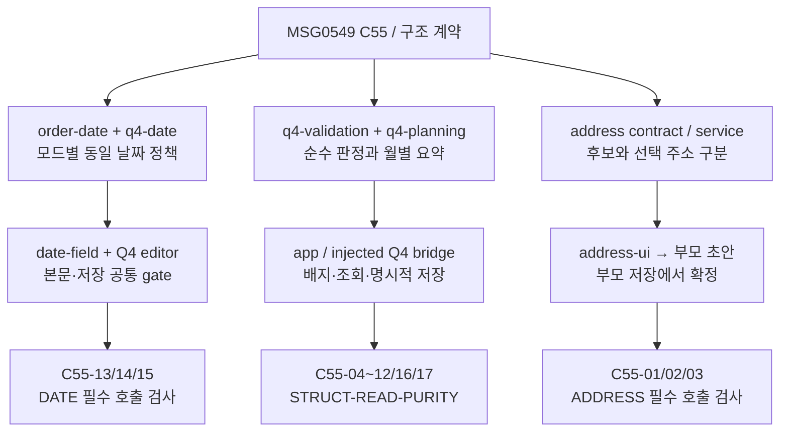

# MSG0549 구조·스타일 소유권과 검사 범위

기준 소스는 `c3800a2dacec92f9a6a8b99345e34eee151ddd84`다. 아래는 그 기준에서 작업 중인 MSG0549 변경의 실제 연결이다. 기준 커밋이 변경 내용을 이미 포함한다는 뜻이 아니다. 검사 JSON의 파일별 SHA256과 하네스 영수증이 실행한 작업 트리를 식별한다. 로컬 구조 검사와 제품 UI·제공자·게시 수락을 구분한다.

## 실제 소유권

| 책임 | 규칙·상태 owner | 실제 호출·저장 경로 | 근거 검사 |
|---|---|---|---|
| 시작과 Q4 연결 | `web/main.mjs` | `createOrderApp()` → `createQ4Review({bridge:app.regularBridge})` → `app.connectQ4(review)` → `await app.boot()` | `STRUCTURE-01/02/07/08` |
| 수치 입력 | `web/numeric-input.mjs` | app 본문과 Q4 편집기가 `bindNumericInputs` 호출; 라벨·단위는 기존 화면 owner | `NUMBER-BODY`, `NUMBER-EDITOR` 필수 호출 검사; 기존 숫자 입력 검사 |
| 주기 생성·선택 | `web/cadence-contract.mjs`, `web/approved-schedule.mjs` | 공통 repeat 계약은 `createApprovedCadence`; Q4 선택은 동일 생성자를 쓰는 `cadenceForPeriod` 및 명시적 편집 동작 | `c55-q4-contract.test.mjs` C55-04/05/06/16, `STRUCT-CADENCE` |
| 공통 날짜 정책 | `web/order-date.mjs`, 모드 옵션 `web/q4-date.mjs` | `date-field` 입력·달력, Q4 표시/검사, `q4-validation` 저장 gate, `OrderDatePolicy.validate` 호환 별칭이 같은 검사 사용 | `date-0549.test.mjs` C55-13/14/15, `date-field-0549.test.mjs`; `DATE-*` 필수 호출 검사 |
| 날짜 화면 | `web/date-field.mjs`, `web/date-field.css` | Q4 `approvedDateSection` / `bindApprovedDateFields`가 markup/binding을 호출; FIXED/ONCE 필수 여부와 기간은 옵션 | 위 날짜 검사; 스타일 파일은 이번 정리에서 변경 없음 |
| Q4 판정 | `web/q4-validation.mjs` | 공통 `validateOrderDraft`가 현재/구형 owner를 먼저 선택; app `q4ReviewVerdict`는 공통 결과를 사용; editor bridge도 같은 `inspectQ4Allocation` 사용 | `Q4-COMMON-VERDICT/GROUPS`, `Q4-SHARED-VERDICT` 필수 호출 검사; 제품 gate 검사 |
| 월간 요약 | `web/q4-planning.mjs` | Q4 `monthlyResultData` → `repeatVisitPlan` / `nominalQuantity` / `sumNominalByReference`; 기준월·알려진 0·미확정 구분 | C55-08/09/10/11/12/16; `Q4-VISITS/QUANTITY/REFERENCE-MONTH` |
| 편집 초안과 읽기 | Q4 private `state`, `repeatForSite`, `serializedAllocations` | repeat snapshot에만 표시용 날짜를 계산; 완료/dirty/summary 조회가 편집 원본을 수정하지 않음 | `c55-q4-consumers.test.mjs` `STRUCT-READ-PURITY`, 동결 초안 반복 조회 |
| 확정 상태와 내구 저장 | app `S` / `save`, `web/storage.mjs` | Q4 `bridge.commit` → app `q4ReviewCommit` → 단일 `save` → storage adapter. UI가 storage를 직접 호출하지 않음 | `STRUCTURE-07/08`, 기존 저장·취소·충돌 검사 |
| 주소 후보·선택 | `address-contract` / `address-service` / `address-ui` | app `createAddressEditor`; PLACE 선택 1건만 resolve; 자식 결과는 부모 초안에만 반영 | C55-01/02/03, `ADDRESS-*` 필수 호출 검사 |
| 공통 UI | `web/common-ui.mjs` | 기존 modal/accordion/copy/icons/disclosure window 공개 owner 유지; 전체 제공자·호출자 JSON으로 추적 | `STRUCTURE-05`; 기존 UI/저장 검사 |
| 스타일 | `web/styles.css` 승인된 컴포넌트 규칙과 variant | 아래 5개 동일 규칙 중 이전 사본 제거, 승인 paired-field 선언 통합 | 정적 동등성 근거 + 별도 실제 화면 검증 |

ONCE 기간은 `ONCE_LEGACY`, FIXED 기간은 `D1R6` 옵션으로 분리한다. 기간 통합, 167판 중심 요약, 새로운 근접 주기 허용 경계는 이 구조 정리로 승인하지 않는다. 기존 저장 의미는 저장 이관 계층과 repeat 호환 계약에서 유지한다.

## 요구 → 규칙 owner → 사용처 → 검사

아래 화살표는 요구의 적용과 실제 사용처 관계다. 계산 정답이나 브라우저 실행을 그림 자체가 증명하지 않는다. `web/main.mjs`, `q4-date.mjs`, `q4-validation.mjs`, `q4-review.mjs`, `app.mjs`와 검사 파일에서 확인한 경로만 표시한다.

시작 연결은 `STRUCTURE-01/02`, 공유 저장 bridge는 `STRUCTURE-07/08`이 별도로 강제한다. `main`은 app·editor의 객체를 실제로 연결한다. `window.OrderQ4Review`, `window.OrderRegularQ4Bridge`, `window.__orderReviewBoot`는 기존 검사/호환을 위한 공개 면으로 남을 수 있지만 app과 editor 사이의 실제 메서드 호출은 주입된 객체를 사용해야 한다.

## 정적 gate와 반례

진입점: `node scripts/engine/check-structure-0549.mjs` (`--json`은 전체 출처·호출자 map). 오류가 있으면 exit 1이다. API는 `checkStructure(root,{overrides})`이며 반례는 디스크 제품을 변경하지 않는 메모리 override로 주입한다. 새 `test/engine/structure-0549.test.mjs`는 기존 Node runner의 재귀 검색으로 `npm test` / `npm run test:engine`에 포함된다. CI의 별도 CLI 연결 여부는 최종 workflow diff/실행으로 확인한다. 구조 작업자의 최종 `structure-tests-04`는 8/8 PASS(7개 결함 주입 탐지), `structure-map-02`는 오류 0이다. 이후 제품 변경은 최종 통합 CI에서 다시 확인한다.

| ID | 실제로 검사하는 실패 |
|---|---|
| STRUCTURE-01 | 제품 구문·상대 import/re-export/literal dynamic import, 모듈 존재, required import+export+실제 call, main 객체 연결, 사용자 정의 window 제공자·호출자 |
| STRUCTURE-02 | import를 남겨도 `app.connectQ4(review)`를 제거하면 실패 |
| STRUCTURE-03 | 숫자 owner가 app을 다시 import하는 새 순환이면 실패 |
| STRUCTURE-04 | 계산 엔진이 dynamic import로 UI를 참조해도 실패 |
| STRUCTURE-05 | 실제 제공자가 없는 새 window owner를 호출하면 실패 |
| STRUCTURE-06 | import만 남기고 공통 날짜 검사 호출을 끊으면 실패 |
| STRUCTURE-07 | app에 저장 provider가 있어도 Q4의 주입된 `commit` 호출을 끊으면 실패 |
| STRUCTURE-08 | Q4가 다시 window bridge로 저장하면 실패 |

main은 전달한 bridge, 연결한 review 객체, connect-before-boot 순서를 AST로 확인한다. `OrderDatePolicy.validate`의 기존 별칭은 import → 해당 window owner의 반환 속성 → 실제 메서드 사용까지 따라간다. `window.*`, `globalThis.*`, bare `Order*`, `const datePolicy=window.OrderDatePolicy` 같은 직접 별칭을 map에 포함한다. 주입 bridge의 `inspect/isCurrent/allocationContext/commit/closed`는 provider 메서드와 실제 Q4 호출을 모두 확인한다.

이는 정적 연결 검사다. 계산 정확성·조건 분기의 실행 여부·DOM 상태·브라우저 전역의 런타임 초기화·임의 계산 속성·복잡한 동적 alias를 완전 증명하지 않는다. 비문자열 dynamic import는 해결 불가능하므로 실패시킨다. 계산 검사는 독립 기대값, 읽기 순수성은 동결 입력 검사, 실제 초기화는 브라우저 관측이 담당한다.

## 승인 스타일의 실제 정리

`styles.css`에서 아래 규칙은 동일 selector·최상위 문맥·동일 선언으로 두 번 존재했다. 앞쪽 규칙만 지우고 더 늦은 규칙을 그대로 유지했다. 같은 요소에 둘 다 적용되면 더 늦은 동일 선언이 항상 우선하므로 중간의 다른 규칙이나 상태가 제거된 앞쪽 사본을 최종 승자로 만들 수 없다. 서로 다른 값·media 문맥·shorthand 관계를 가진 반복 규칙은 이 증거로 삭제하지 않았다.

| 최종 owner | 그대로 유지한 최종 값 | 정리 |
|---|---|---|
| `.allocation-item:last-child` | `border-bottom:0` | 이전 사본 제거 |
| `.q4-regular-dialog .qa-calendar-grid button:disabled` | transparent background, `--muted`, opacity `.42`, not-allowed | 이전 사본 제거 |
| `.ui-site-summary[data-valid="false"]` | `color:var(--ui-danger)` | 이전 사본 제거 |
| `.q4-regular-dialog .qa-site-field,.q4-regular-dialog .qa-field` | `gap:var(--ui-field-control-gap)` | 이전 사본 제거 |
| `.q4-regular-dialog .qa-holiday-fields` | `gap:var(--ui-field-nested-gap)` | 이전 사본 제거 |
| `.qa-repeat-pair` / `.qa-order-quantity-pair` | 동일한 두 grid track, `--ui-pair-gap`, start alignment | 바로 인접한 두 동일 선언을 한 selector group으로 통합 |

pair의 390px 이하 공통 14px 간격, 360px 이하 repeat 전용 `.8fr/1.2fr`·12px 간격은 원래 위치와 조건을 유지한다. 새 token·색상·폰트·motion·회사 선택/테마를 추가하지 않았다. C1R/M2/S2의 승인된 역할·광학 보정은 변경하지 않았다.

전후 원문과 줄 번호·SHA256은 실행 증거 `context/0549/structure/style-consolidation.json` 및 `styles.before.css`에 있다. 정적 증거는 computed-style 비교가 아니다. `test/browser/structure-0549.smoke.mjs`는 SHA256으로 고정한 기준 CSS와 현재 build CSS를 같은 합성 DOM에 교체해 320/375/1440 × normal/disabled/error/focus/selected 15개 조합의 computed style·geometry와 전후 캡처를 비교한다. 제품 JavaScript·제공자·저장은 실행하지 않는다. 이 작업에서 문법 검사만 PASS이며 실제 Chromium 실행은 CI에 남아 있다. 이 구조 작업자에게 320/375/PC, 긴 한국어 장소명, 200% 확대, disabled/error/focus/selected 상태, 사용자 OS 시각 검수는 **NOT_RUN**이다. 통합 실행 담당의 별도 실제 관측만 이 상태를 갱신한다.

## 고정 원문 적용과 검수 구분

| 고정 원문 | 읽고 적용한 범위 | 실제 증거와 제한 |
|---|---|---|
| Ponytail `96608e078b2d` audit/review | 기존 owner·entry·호출자 먼저 조사, 책임 단위의 작은 변경, 연결된 diff 확인 | 실제 CSS 사본 제거, window 잔여 호출 발견·연결 gate. CLI/hook 설치 없음 |
| Jakub better-layout `60bf140e43c9` | 기존 간격·밀도 우선, shared edges, 좁은 화면/긴 라벨 clipping 확인 항목 | 승인 pair tracks/media 보존. 이 작업자의 실제 viewport/zoom 검수 NOT_RUN |
| MIFB `35545ea1512a` | 기존 CSS 체계 사용, typography·동적 숫자·상태를 함께 검토 | 기존 `tabular-nums/currentColor`, label wrapping, 44px 입력을 보존. 새 animation 없음; 실제 polish 판정 NOT_RUN |
| Cloudflare security-audit `c1c8a8c14710` guidance / CLIENT-SIDE | 변경된 입력·DOM·선택·저장·secret 경계를 source-first 검토 | 아래 제한된 변경 검토; 전체 감사·공격 실행·배포 보안 PASS 아님 |
| Archify `a4065941f12b` SKILL / repository-authoring | 실제 source/caller/I/O owner를 근거로 표시하고 unknown 명시 | 위 동등한 Mermaid 구조도와 Acorn map. Archify 설치·HTML/browser-check 실행 없음 |

MIFB 전체 요청 범위 중 typography는 숫자·긴 라벨 관련 소스를, surfaces는 기존 상태 selector를 확인했다. icons/performance/animations는 새 변경이 없으며 기존 값 보존만 확인했다. 새 시각적 결함이 없다고 실제 화면 수락을 부여하지 않는다. 외부 지침의 예시 수치로 승인 UI를 교체하거나, 다른 media의 반복 규칙을 일괄 삭제하는 방안은 거절했다.

## 변경 경계 보안 검토

범위는 현재 변경의 main/app/Q4/date 연결과 주소 변경의 source 경계다. 가정하는 동작은 한 브라우저의 비공개 초안·동일 origin 저장, Pages Function의 서버 제공자 요청이다. 전체 저장소 보안 감사 또는 실제 운영 설정 검증은 수행하지 않았다.

- main은 기존 browser 저장 owner를 연결하며 새 네트워크·권한·저장 sink를 추가하지 않는다. Q4 저장은 주입 bridge를 거쳐 기존 revision/token/`canCommit` 검사와 단일 app `save`로 간다. 사용자 정의 window 호환 공개 자체를 다른 사용자 권한 침해로 판정하지 않는다.
- date/Q4의 새 순수 검사 결과는 기존 UI escape/text 출력 경로가 소비한다. 읽기와 검사로 기존 저장 날짜를 바꾸지 않는 계약은 별도 동결 초안 검사로 확인해야 한다. 정적 map만으로 순수성을 선언하지 않는다.
- 주소 Function은 고정 Kakao host/path와 서버 Authorization을 사용한다. 선택 resolve는 원 검색어/페이지/placeId를 재확인하고 유일한 우편주소를 요구한다. 클라이언트가 임의 URL·주소·상호를 resolve 입력에 넣는 경로는 받지 않는다. 검색 PLACE에는 확인된 우편주소 provenance를 부여하지 않는다.
- 서비스는 v3 shape·길이·타입·페이지 metadata·중복을 검증하고, UI의 provider name/road/jibun은 `textContent`로 출력한다. `innerHTML`은 기존 정적 icon만 사용한다. 선택 정보의 검색 metadata는 `addressFields`에서 제외하며 부모 저장 경계를 유지한다.
- 주소 취소·세대 번호 guard와 캐시 취소 경계는 source와 해당 작업자의 합성 회귀 근거로 확인한다. 실제 transport 수·제공자 데이터·키·Cloudflare 설정·공개 응답 헤더·실제 비용은 **NOT_RUN/미확인**이다.

이 범위의 소스 검토에서 새로운 권한 경계 침해를 확정하지 않았다. OS로 강제한 독립 보안 실행 환경의 모든 조건을 이 작업에서 확보·검증하지 않았으므로 별도 보안 공격 실행은 하지 않았다. 일반 제품 회귀 결과를 전체 보안 감사 인증으로 확대하지 않는다.
